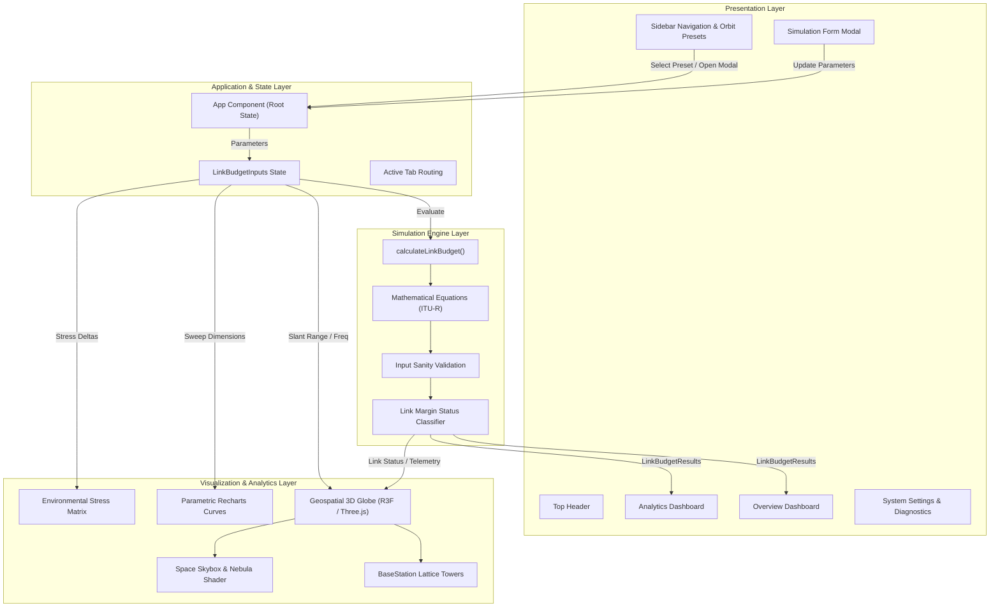
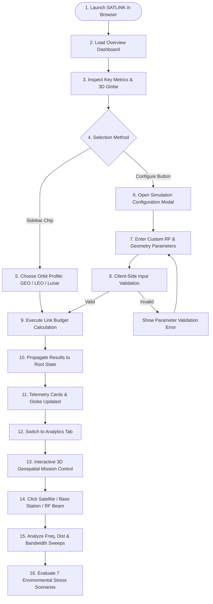

# SATLINK — Satellite Communication Link Budget Simulator

> **Deterministic RF Link Budget Engineering Platform, Parametric Analytics & Interactive 3D Geospatial Orbit Visualization**

---

## Table of Contents

1. [Project Overview](#1-project-overview)
   - [Problem Statement](#problem-statement)
   - [Project Objectives](#project-objectives)
   - [Main Features](#main-features)
   - [Intended Users](#intended-users)
   - [Scope & Limitations](#scope--limitations)
2. [System Architecture](#2-system-architecture)
   - [Presentation Layer](#presentation-layer)
   - [Application & State Management Layer](#application--state-management-layer)
   - [Simulation Engine Layer](#simulation-engine-layer)
   - [Visualization & Analytics Layer](#visualization--analytics-layer)
   - [Architecture Diagram](#architecture-diagram)
3. [File System Architecture](#3-file-system-architecture)
4. [Technology Stack](#4-technology-stack)
5. [Link-Budget Calculation Engine](#5-link-budget-calculation-engine)
   - [Input Parameters](#input-parameters)
   - [Mathematical Formulation](#mathematical-formulation)
   - [Link Margin & Status Thresholds](#link-margin--status-thresholds)
6. [Application Workflow](#6-application-workflow)
7. [Practical Example — GEO Ku-Band Simulation](#7-practical-example--geo-ku-band-simulation)
8. [Available Satellite Presets](#8-available-satellite-presets)
9. [Analytics & Performance Visualizations](#9-analytics--performance-visualizations)
10. [Environmental Stress Analysis](#10-environmental-stress-analysis)
11. [Installation & Execution](#11-installation--execution)
12. [Project Limitations & Assumptions](#12-project-limitations--assumptions)
13. [Future Enhancements](#13-future-enhancements)
14. [Screenshots & Visual Documentation](#14-screenshots--visual-documentation)

---

## 1. Project Overview

**SATLINK** is an interactive, browser-based Satellite Communication Link Budget Simulator designed for aerospace engineers, telecommunications students, satellite operators, and system architects. It combines rigorous, deterministic RF link budget calculations adhering to **ITU-R P.618-13 space telecommunication standards** with real-time parametric sensitivity curves, multi-orbit mission presets, and an interactive **3D WebGL Earth & satellite geospatial visualization**.

### Problem Statement

Designing and verifying a satellite communications link requires balancing multiple interrelated RF parameters: transmission frequency, slant path distance, transponder amplifier power, parabolic antenna gains, atmospheric and precipitation attenuation, receiver figure of merit ($G/T$), and bandwidth. Traditionally, engineers execute these calculations using static spreadsheets or disconnected command-line scripts that lack visual context, live parameter sweeps, and spatial intuition for orbital geometry.

### Project Objectives

- **Deterministic Accuracy:** Provide a mathematically rigorous, zero-mock calculation engine executing real-time link budgets in compliance with ITU-R space telecommunication equations.
- **Interactive Sensitivity Sweeps:** Enable instant exploration of how varying frequency, distance, bandwidth, and environmental attenuation impacts carrier-to-noise ratio ($C/N$) and link margin.
- **Spatial Intuition:** Provide an interactive 3D Earth and orbital visualization showing satellite altitude, orbital inclination, subsatellite points (SSP), and global ground station teleports.
- **Environmental Stress Modeling:** Evaluate communications links against realistic atmospheric disturbances, including tropical rain fade, convective storm cells, antenna pointing misalignment, and high-power amplifier (HPA) back-off.
- **Modern Aerospace UI:** Deliver an experimental **Glassmorphism × Brutalist Space UI** optimized for technical clarity, legibility, and high-contrast telemetry monitoring.

### Main Features

- **Live Calculation Engine:** Instant computation of Effective Isotropic Radiated Power (EIRP), Free Space Path Loss (FSPL), Received Carrier Power ($P_{\text{rx}}$), Carrier-to-Noise Spectral Density ($C/N_0$), Carrier-to-Noise Ratio ($C/N$), and Link Margin.
- **Multi-Orbit Mission Presets:** One-click configuration for Geostationary Orbit (**GEO C-Band**), Low Earth Orbit (**LEO Ku-Band**), and Deep Space Lunar Relay (**Lunar Relay**).
- **Interactive 3D Geospatial Mission Control:** Three.js and React Three Fiber powered 3D Earth with true spherical coordinates, rotating orbital planes, coverage footprint projection, and 7 worldwide ground station teleports.
- **Procedural 3D Base Station Towers:** Ground stations modeled with concrete pads, equipment shelters, 6-level lattice towers, sector panel antennas with RF radome textures, microwave backhaul dishes, obstacle beacons, and animated RF radiation rings.
- **Procedural Space Skybox:** Deep space environment with procedural volumetric nebula shaders, 3-tier starfields with mouse parallax, and shooting stars.
- **Parametric Analytics (Recharts):** High-density responsive plots covering Frequency vs. FSPL (1.2 GHz to 44 GHz across L, S, C, X, Ku, K/Ka, and Q/V bands), Distance vs. Received Power (200 km LEO to 384,400 km Lunar), and Bandwidth vs. $C/N$.
- **Environmental Stress Analysis Matrix:** 7-scenario automated degradation matrix with color-coded operational margins.
- **Engine Diagnostics & Self-Test Suite:** 15 automated validation test scenarios accessible from System Settings and runnable via CLI (`npm test`).

### Intended Users

- **Satellite Communications Engineers:** Rapid feasibility assessments, link budget margin verification, and transponder power planning.
- **University Faculty & Students:** Hands-on instruction in microwave engineering, orbital communication geometry, and space system engineering.
- **Earth Station Operators:** Evaluation of antenna dish sizing, receiver $G/T$ requirements, and rain fade tolerances.

### Scope & Limitations

SATLINK models line-of-sight satellite communications links using classical RF propagation and spherical Earth geometry. It is designed for deterministic educational and engineering analysis rather than real-time orbital tracking with NORAD Two-Line Element (TLE) sets or live weather radar assimilation.

---

## 2. System Architecture

SATLINK follows a clean, single-direction data flow architecture built in React and TypeScript with zero backend dependencies, allowing it to run completely client-side in any modern WebGL-capable web browser.



### Presentation Layer

- **Sidebar Navigation ([`src/components/layout/Sidebar.tsx`](src/components/layout/Sidebar.tsx)):** Desktop collapsible and mobile-responsive drawer with active tab indicators, one-click Orbit Mission presets (GEO, LEO, Lunar), real-time telemetry badge, and system status footer.
- **Top Header ([`src/components/layout/Header.tsx`](src/components/layout/Header.tsx)):** Minimalist header presenting the active module title with a translucent glass background.
- **Overview Dashboard ([`src/components/dashboard/Dashboard.tsx`](src/components/dashboard/Dashboard.tsx)):** Primary mission control summary displaying key metric cards (EIRP, FSPL, $C/N$, Link Margin), the 3D orbital geometry globe, active configuration parameters, and the operational link status badge.
- **Simulation Configuration Modal ([`src/components/simulation/SimulationForm.tsx`](src/components/simulation/SimulationForm.tsx)):** Interactive modal with numeric step inputs, validation error alerts, and quick preset selector chips.
- **Analytics Dashboard ([`src/components/analytics/AnalyticsDashboard.tsx`](src/components/analytics/AnalyticsDashboard.tsx)):** Advanced telemetry workspace housing the full-scale 3D Geospatial Mission Control Globe, 2×2 parametric Recharts sweep charts, and the 7-scenario environmental stress breakdown table.
- **Metric Cards ([`src/components/dashboard/MetricCard.tsx`](src/components/dashboard/MetricCard.tsx)):** Brutalist metric cards featuring large tabular figures, engineering units, icons, and status indicators.

### Application and State Management Layer

- **Root State ([`src/App.tsx`](src/App.tsx)):** The root component manages the canonical application state using standard React hooks (`useState`). It maintains:
  - `activeTab`: Current visible view (`"Overview"`, `"Analytics"`, or `"Settings"`).
  - `parameters`: Active `LinkBudgetInputs` object initialized to `DEFAULT_PARAMETERS` (GEO C-Band).
  - `isConfigOpen`: Boolean state controlling the configuration modal.
- **Single Source of Truth:** Any parameter modification in the sidebar presets, settings view, or simulation modal immediately updates `parameters` in `App.tsx`.
- **Reactive Propagation:** Both `Dashboard` and `AnalyticsDashboard` receive `parameters` as props and compute `results` using `useMemo(() => calculateLinkBudget(parameters), [parameters])`. This guarantees 100% calculation consistency across the entire application without state synchronization race conditions.

### Simulation Engine Layer

- **Calculation Core ([`src/simulation/calculations.ts`](src/simulation/calculations.ts)):** Pure deterministic TypeScript function `calculateLinkBudget(inputs: LinkBudgetInputs): LinkBudgetResults`.
- **Physical Constants ([`src/simulation/constants.ts`](src/simulation/constants.ts)):** Exports standard physical figures, notably Boltzmann's constant in decibel form ($\text{BOLTZMANN\_DB} = 228.6\text{ dBW/K/Hz}$) and default GEO link figures.
- **Type Definitions ([`src/simulation/types.ts`](src/simulation/types.ts)):** Strict TypeScript contracts defining `LinkBudgetInputs` and `LinkBudgetResults`.

### Visualization and Analytics Layer

- **Interactive 3D Mission Control ([`src/components/analytics/GeospatialAnalyticsGlobe.tsx`](src/components/analytics/GeospatialAnalyticsGlobe.tsx)):** Built with `@react-three/fiber` and `@react-three/drei`. Features Earth sphere with satellite craft orbiting at scaled slant range distances, instantaneous Subsatellite Point (SSP) projection, RF line-of-sight propagation vector with animated traveling pulse, and ground telemetry HUD overlays.
- **Lattice Tower Ground Stations ([`src/components/ui/base-station.tsx`](src/components/ui/base-station.tsx)):** Renders teleports with structural lattice trusses, antenna sector arrays, microwave backhaul dishes, obstacle beacons, and pulsing signal rings.
- **Cosmic Environment ([`src/components/ui/space-background.tsx`](src/components/ui/space-background.tsx)):** Custom WebGL shaders generating dynamic nebulas, 3-layer twinkling starfields with pointer parallax, and streak shooting stars.
- **Parametric Charts:** Recharts-driven responsive plots mapping deterministic variations across frequency, distance, and bandwidth dimensions.

---

## 3. File System Architecture

```
satlink-simulator/
├── public/                                # Static public web assets
│   ├── textures/                          # 3D models & panel textures
│   │   ├── antenna-panel.jpg              # Sector antenna panel radome texture
│   │   ├── satellite-body.jpg             # Satellite chassis metallic texture
│   │   └── solar-panel.jpg                # Photovoltaic solar array texture
│   ├── earth-texture.jpg                  # High-resolution photorealistic Earth map
│   ├── favicon.svg                        # Satellite icon favicon
│   └── ground-station-marker.svg          # Teleport pin SVG icon
├── src/
│   ├── assets/                            # Application imagery
│   │   └── hero.png                       # Conceptual hero artwork
│   ├── components/
│   │   ├── analytics/                     # Deep-dive analytics views
│   │   │   ├── AnalyticsDashboard.tsx     # 2×2 parametric sweeps & stress table
│   │   │   └── GeospatialAnalyticsGlobe.tsx # 3D Earth, orbit & ground teleports
│   │   ├── dashboard/                     # Primary mission control view
│   │   │   ├── Dashboard.tsx              # Overview telemetry dashboard
│   │   │   └── MetricCard.tsx             # Brutalist metric card component
│   │   ├── layout/                        # Layout structure
│   │   │   ├── Header.tsx                 # Top navigation header
│   │   │   └── Sidebar.tsx                # Navigation drawer & orbit presets
│   │   ├── settings/                      # Engine configuration & diagnostics
│   │   │   └── SettingsView.tsx           # Physical constants & automated test runner
│   │   ├── simulation/                    # Input modal
│   │   │   └── SimulationForm.tsx         # Comprehensive parameter configuration form
│   │   ├── ui/                            # Reusable UI & 3D elements
│   │   │   ├── 3d-globe.tsx               # Base Aceternity 3D globe component
│   │   │   ├── base-station.tsx           # Procedural 3D lattice antenna tower
│   │   │   ├── satellite.tsx              # Procedural 3D satellite model with solar wings
│   │   │   ├── shooting-stars.tsx         # Canvas-based 2D background shooting stars
│   │   │   ├── sidebar.tsx                # Framer Motion animated desktop/mobile sidebar
│   │   │   ├── sidebar-context.tsx        # React context for sidebar open state
│   │   │   ├── space-background.tsx       # Three.js 3D nebula, starfield & shooting stars
│   │   │   ├── StarBorder.tsx             # Neon animated border wrapper
│   │   │   └── stars-background.tsx       # Canvas-based 2D twinkling starfield
│   │   └── visualization/                 # Overview globe wrapper
│   │       ├── SatelliteGlobe.tsx         # Overview dashboard 3D globe wrapper
│   │       └── SatelliteScene.tsx         # Auxiliary orbital scene
│   ├── lib/
│   │   ├── geo.ts                         # Spherical trigonometry & coordinate transforms
│   │   └── utils.ts                       # ClassName merging utility (clsx + tailwind-merge)
│   ├── simulation/                        # Mathematical simulation core
│   │   ├── calculations.ts                # Deterministic link budget equations
│   │   ├── constants.ts                   # Boltzmann constant & default parameters
│   │   ├── groundStations.ts              # Registry of 7 global teleport coordinates
│   │   ├── simulationTests.ts             # 15-test CLI verification test suite
│   │   ├── testCalculation.ts             # Interactive script calculation tester
│   │   └── types.ts                       # TypeScript interfaces for inputs & results
│   ├── App.tsx                            # Root application component & state hub
│   ├── index.css                          # Tailwind CSS v4 directives & theme styles
│   └── main.tsx                           # React 19 application entry point
├── eslint.config.js                       # ESLint v10 flat configuration
├── index.html                             # Single page HTML entry
├── package.json                           # Project dependencies and npm scripts
├── tsconfig.app.json                      # TypeScript compiler configuration (client)
├── tsconfig.json                          # TypeScript project references
├── tsconfig.node.json                     # TypeScript compiler configuration (node tools)
└── vite.config.ts                         # Vite v8 bundler configuration
```

---

## 4. Technology Stack

| Category | Technology | Verified Version | Purpose & Architectural Rationale |
|---|---|---|---|
| **Frontend Framework** | React | `^19.3.1` | Component-based UI with declarative state updates and high-performance rendering. |
| **DOM Engine** | React DOM | `^19.3.1` | Client-side DOM mounting and concurrent hydration. |
| **Language** | TypeScript | `~6.0.3` | End-to-end type safety, strict interface contracts for simulation equations, and zero runtime type errors. |
| **Build Tool** | Vite | `^8.3.6` | Next-generation frontend bundler providing instantaneous Hot Module Replacement (HMR) and optimized rollup builds. |
| **Styling** | Tailwind CSS | `^4.3.5` | Utility-first styling with `@tailwindcss/vite` plugin implementing glassmorphic blurs, aerospace borders, and responsive layouts. |
| **3D Engine** | Three.js | `^0.187.0` | Comprehensive WebGL library for rendering 3D celestial bodies, orbital geometries, lighting, and textures. |
| **3D React Bridge** | `@react-three/fiber` | `^9.8.2` | Declarative Three.js scene graph management inside React's component lifecycle. |
| **3D Helpers** | `@react-three/drei` | `^10.7.9` | Utilities including `OrbitControls`, `Html` 3D projection, `Line` rendering, and texture loading. |
| **Data Visualization** | Recharts | `^3.10.1` | SVG charting library for responsive parametric frequency, distance, and bandwidth sweeps. |
| **Animation** | Framer Motion | `^14.13.0` | Spring physics animations for sidebar transitions, modals, and metric transitions. |
| **Iconography** | Lucide React | `^1.72.0` | Clean technical iconography for RF components, orbits, and link telemetry. |
| **Icons (Auxiliary)** | Tabler Icons | `^3.51.0` | Complementary aerospace and interface icons (`@tabler/icons-react`). |
| **Class Utilities** | `clsx` & `tailwind-merge` | `^2.1.1` / `^3.7.0` | Conditional class composition and deduplication for dynamic status styles. |
| **Test Execution** | `tsx` | `^4.23.15` | Native TypeScript execution engine for running CLI verification test suites without precompilation. |
| **Code Quality** | ESLint | `^10.14.0` | Strict linter with `typescript-eslint` and React Hooks rules. |

---

## 5. Link-Budget Calculation Engine

The simulation engine implements classical telecommunications physics as codified by the International Telecommunication Union (ITU-R).

### Input Parameters

| Parameter | Identifier | Unit | Valid Range | Physical Description |
|---|---|:---:|:---:|---|
| **Transmitter Power** | `transmitterPower` | $\text{dBW}$ | $\ge -30$ | RF power output by the High-Power Amplifier (HPA) / transponder. |
| **Transmit Antenna Gain** | `transmitAntennaGain` | $\text{dBi}$ | $\ge 0$ | Directional gain of the transmitting parabolic dish relative to isotropic. |
| **Transmit Losses** | `transmitLosses` | $\text{dB}$ | $\ge 0$ | Waveguide, feeder, diplexer, and connector insertion losses on satellite. |
| **Carrier Frequency** | `frequency` | $\text{GHz}$ | $> 0$ | Center microwave frequency of the downlink carrier. |
| **Slant Range Distance** | `distance` | $\text{km}$ | $> 0$ | Line-of-sight path distance between satellite and ground receiver. |
| **Propagation Losses** | `propagationLosses` | $\text{dB}$ | $\ge 0$ | Atmospheric gas absorption, cloud attenuation, and precipitation fade. |
| **Receive Antenna Gain** | `receiveAntennaGain` | $\text{dBi}$ | $\ge 0$ | Directivity gain of the ground receiving parabolic dish antenna. |
| **Receive Losses** | `receiveLosses` | $\text{dB}$ | $\ge 0$ | Ground station feed losses, radome absorption, and polarization mismatch. |
| **Receiver G/T** | `receiverGT` | $\text{dB/K}$ | $-50 \text{ to } 60$ | Receiver Figure of Merit (antenna gain divided by system noise temperature). |
| **Channel Bandwidth** | `bandwidth` | $\text{MHz}$ | $> 0$ | Allocated transponder RF channel bandwidth. |
| **Required C/N** | `requiredCN` | $\text{dB}$ | $\ge 0$ | Demodulation threshold for target Bit Error Rate (BER) and coding (FEC). |

### Mathematical Formulation

#### 1. Effective Isotropic Radiated Power (EIRP)

EIRP represents the total apparent RF power radiated toward the target ground station by an equivalent isotropic antenna:

$$\text{EIRP} = P_{\text{tx}} + G_{\text{tx}} - L_{\text{tx}} \quad (\text{dBW})$$

#### 2. Free Space Path Loss (FSPL)

Electromagnetic wave propagation through free space experiences spherical power dispersion governed by the Friis transmission formula:

$$\text{FSPL} = 20 \log_{10}(d) + 20 \log_{10}(f) + 20 \log_{10}\left(\frac{4\pi \times 10^9 \times 10^3}{c}\right)$$

Evaluating constants with speed of light $c \approx 2.99792458 \times 10^8\text{ m/s}$ yields the standard aerospace equation used in [`calculations.ts`](src/simulation/calculations.ts):

$$\text{FSPL} = 92.45 + 20 \log_{10}(f_{\text{GHz}}) + 20 \log_{10}(d_{\text{km}}) \quad (\text{dB})$$

#### 3. Received Carrier Power ($P_{\text{rx}}$)

The isotropic power incident at the ground terminal antenna aperture after space dispersion and transmission path attenuation:

$$P_{\text{rx}} = \text{EIRP} - \text{FSPL} - L_{\text{prop}} + G_{\text{rx}} - L_{\text{rx}} \quad (\text{dBW})$$

#### 4. Carrier-to-Noise Density Ratio ($C/N_0$)

$C/N_0$ relates carrier power to noise power spectral density ($N_0 = k \cdot T_s$), independent of channel bandwidth. In decibel formulation with Boltzmann's constant $k = 1.380649 \times 10^{-23}\text{ J/K}$ (where $-10 \log_{10}(k) = +228.6\text{ dBW/K/Hz}$):

$$C/N_0 = \text{EIRP} - \text{FSPL} - L_{\text{prop}} + (G/T)_{\text{rx}} + 228.6 \quad (\text{dB}\cdot\text{Hz})$$

#### 5. Carrier-to-Noise Ratio ($C/N$)

The ratio of received carrier power to total thermal noise power ($N = k \cdot T_s \cdot B$) over the allocated channel bandwidth $B$:

$$\text{Bandwidth}_{\text{Hz}} = B_{\text{MHz}} \times 10^6$$

$$C/N = C/N_0 - 10 \log_{10}(\text{Bandwidth}_{\text{Hz}}) \quad (\text{dB})$$

#### 6. Link Margin

The operational safety margin above the receiver's demodulation threshold:

$$\text{Link Margin} = (C/N)_{\text{calculated}} - (C/N)_{\text{required}} \quad (\text{dB})$$

### Link Margin & Status Thresholds

SATLINK categorizes link health into four industry-standard operational tiers based on calculated Link Margin ($\Delta M$):

| Status | Condition | Severity / Indicator | Engineering Meaning |
|---|:---:|:---:|---|
| **EXCELLENT** | $\Delta M \ge 10\text{ dB}$ | Emerald (`#10b981`) | Link significantly exceeds threshold; immune to severe rain fade; maximum availability. |
| **GOOD** | $3\text{ dB} \le \Delta M < 10\text{ dB}$ | White (`#ffffff`) | Nominal operational link budget; compliant with standard 99.9% availability targets. |
| **MARGINAL** | $0\text{ dB} \le \Delta M < 3\text{ dB}$ | Amber (`#f59e0b`) | Vulnerable link; minor atmospheric turbulence or light rain may trigger service disruption. |
| **FAILED** | $\Delta M < 0\text{ dB}$ | Rose (`#f43f5e`) | Link closed negative; transponder demodulator experiences sync loss or high Bit Error Rate. |

---

## 6. Application Workflow



1. **Launch:** Access the web application at `http://localhost:5173`.
2. **Overview:** Review active downlink figures on the four brutalist metric cards (EIRP, FSPL, $C/N$, Link Margin).
3. **Orbit Selection:** Select a preset from the sidebar (GEO C-Band, LEO Ku-Band, or Lunar Relay) to load calibrated satellite parameters.
4. **Custom Tuning:** Click **Configure Simulation** to open the modal and adjust frequency, power, slant distance, gains, or losses.
5. **Real-time Recalculation:** The engine executes instantly upon input submission.
6. **Analytics Exploration:** Navigate to **Analytics & Sweeps** to inspect the 3D Geospatial Mission Control globe.
7. **Spatial Inspection:** Click on the satellite model, ground station towers, or RF communication beam to inspect telemetry in floating glass inspectors.
8. **Parametric Sensitivity:** Inspect the 2×2 Recharts grid to determine path loss across frequency bands and power drop-off across orbital regimes.
9. **Stress Testing:** Review the environmental table to verify whether the link maintains positive margin during a severe convective storm or antenna misalignment.

---

## 7. Practical Example — GEO Ku-Band Simulation

The following example demonstrates a real-world broadcast downlink from a Geostationary satellite to a consumer Earth station:

### Input Parameters

```typescript
const geoKuBandInputs: LinkBudgetInputs = {
  transmitterPower: 25.0,        // 25.0 dBW (~316 Watts RF amplifier)
  transmitAntennaGain: 42.0,     // 42.0 dBi satellite dish
  transmitLosses: 1.5,           // 1.5 dB satellite feeder/diplexer loss
  frequency: 12.0,               // 12.0 GHz Ku-band carrier
  distance: 35800.0,             // 35,800 km GEO slant range
  propagationLosses: 2.0,        // 2.0 dB atmospheric and water vapor attenuation
  receiveAntennaGain: 38.0,      // 38.0 dBi ground terminal antenna (~1.2m dish)
  receiveLosses: 1.0,            // 1.0 dB feed and connector loss
  receiverGT: 18.0,              // 18.0 dB/K low-noise block figure of merit
  bandwidth: 54.1,               // 54.1 MHz transponder channel bandwidth
  requiredCN: 12.0,              // 12.0 dB threshold for QPSK / 8PSK demodulation
};
```

### Calculation Breakdown

1. **EIRP:**
   $$\text{EIRP} = 25.0 + 42.0 - 1.5 = \mathbf{65.50\text{ dBW}}$$

2. **Free Space Path Loss (FSPL):**
   $$\text{FSPL} = 92.45 + 20 \log_{10}(12.0) + 20 \log_{10}(35800.0)$$
   $$\text{FSPL} = 92.45 + 21.5836 + 91.0777 = \mathbf{205.11\text{ dB}}$$

3. **Received Carrier Power ($P_{\text{rx}}$):**
   $$P_{\text{rx}} = 65.50 - 205.11 - 2.0 + 38.0 - 1.0 = \mathbf{-104.61\text{ dBW}}$$

4. **Carrier-to-Noise Density ($C/N_0$):**
   $$C/N_0 = 65.50 - 205.11 - 2.0 + 18.0 + 228.60 = \mathbf{104.99\text{ dB}\cdot\text{Hz}}$$

5. **Carrier-to-Noise Ratio ($C/N$):**
   $$\text{Bandwidth}_{\text{Hz}} = 54.1 \times 10^6\text{ Hz} \implies 10 \log_{10}(54.1 \times 10^6) = 77.332\text{ dB}\cdot\text{Hz}$$
   $$C/N = 104.99 - 77.33 = \mathbf{27.66\text{ dB}}$$

6. **Link Margin & Status:**
   $$\text{Margin} = 27.66 - 12.00 = \mathbf{+15.66\text{ dB}} \implies \mathbf{EXCELLENT} \quad (\ge 10\text{ dB})$$

### Engineering Interpretation

With an operational link margin of **$+15.66\text{ dB}$**, this downlink is exceptionally robust. It can absorb severe rain fade (e.g., $+10\text{ dB}$ storm attenuation) while maintaining continuous carrier lock and error-free broadcast demodulation.

---

## 8. Available Satellite Presets

SATLINK includes three pre-configured mission presets accessible from the sidebar and configuration modal:

| Parameter | GEO C-Band (Default) | LEO Ku-Band Constellation | Deep Space Lunar Relay |
|---|:---:|:---:|:---:|
| **Target Distance** | $35,786\text{ km}$ | $550\text{ km}$ | $384,400\text{ km}$ |
| **Downlink Frequency** | $4.00\text{ GHz}$ | $12.00\text{ GHz}$ | $8.40\text{ GHz}$ |
| **Transmitter Power** | $20.0\text{ dBW}$ ($100\text{ W}$) | $14.0\text{ dBW}$ ($25\text{ W}$) | $25.0\text{ dBW}$ ($316\text{ W}$) |
| **Tx Antenna Gain** | $40.0\text{ dBi}$ | $34.0\text{ dBi}$ | $48.0\text{ dBi}$ (High-gain dish) |
| **Tx Losses** | $1.0\text{ dB}$ | $1.0\text{ dB}$ | $1.0\text{ dB}$ |
| **Propagation Loss** | $1.5\text{ dB}$ | $2.2\text{ dB}$ | $0.5\text{ dB}$ (Vacuum/Deep space) |
| **Rx Antenna Gain** | $35.0\text{ dBi}$ | $38.0\text{ dBi}$ | $60.0\text{ dBi}$ (Deep Space Network) |
| **Rx Losses** | $1.0\text{ dB}$ | $1.0\text{ dB}$ | $1.0\text{ dB}$ |
| **Receiver G/T** | $15.0\text{ dB/K}$ | $12.0\text{ dB/K}$ | $28.0\text{ dB/K}$ (Cryogenic DSN dish) |
| **Channel Bandwidth** | $36.0\text{ MHz}$ | $250.0\text{ MHz}$ | $5.0\text{ MHz}$ (Narrowband telemetry) |
| **Required C/N** | $10.0\text{ dB}$ | $8.0\text{ dB}$ | $6.0\text{ dB}$ (Deep space LDPC coding) |
| **Resulting Margin** | **$+19.97\text{ dB}$** (EXCELLENT) | **$+14.93\text{ dB}$** (EXCELLENT) | **$+17.47\text{ dB}$** (EXCELLENT) |

---

## 9. Analytics & Performance Visualizations

The **Analytics Dashboard** provides interactive visual representations of satellite link physics:

### 1. Interactive 3D Geospatial Mission Control Globe
- **Earth Sphere:** Renders a 3D Earth textured with satellite maps and surrounded by atmospheric limb glow and an orbital coordinate grid (equator, tropics, and meridians).
- **Global Ground Stations:** Pinpoints 7 international teleports:
  - Bengaluru Gateway ($12.97^\circ\text{N}, 77.59^\circ\text{E}$)
  - New Delhi Teleport ($28.61^\circ\text{N}, 77.21^\circ\text{E}$)
  - Singapore Equator Hub ($1.35^\circ\text{N}, 103.82^\circ\text{E}$)
  - London Goonhilly Station ($51.51^\circ\text{N}, -0.13^\circ\text{E}$)
  - Tokyo Space Center ($35.68^\circ\text{N}, 139.65^\circ\text{E}$)
  - New York Deep Space Node ($40.71^\circ\text{N}, -74.01^\circ\text{E}$)
  - Canberra / Sydney Tracking Station ($-33.87^\circ\text{N}, 151.21^\circ\text{E}$)
- **Procedural Base Station Towers:** Real 3D structural lattice towers with outward sector panels, microwave dishes, red hazard beacons, and pulsing signal rings.
- **Subsatellite Point (SSP):** Computes instantaneous subpoint latitude/longitude coordinates on Earth's surface directly beneath the orbiting craft, displaying a crosshair reticle and ground coverage footprint circle.
- **RF Communication Beam:** Displays a vector connecting the satellite and the active ground teleport with animated signal propagation pulses color-coded by link margin health.
- **Interactive Inspectors:** Click to inspect satellite craft telemetry, ground teleport aperture metrics, or RF line-of-sight slant attenuation.

### 2. Frequency vs. Free Space Path Loss (FSPL)
- **Chart Type:** Area Chart with reference lines.
- **Range:** Sweeps from $1.2\text{ GHz}$ to $44.0\text{ GHz}$ across IEEE frequency bands (L, S, C, X, Ku, K, Ka, and Q/V).
- **Physical Law:** Demonstrates the logarithmic $20 \log_{10}(f)$ increase in dispersion loss (every doubling of carrier frequency incurs $+6.02\text{ dB}$ of path loss).

### 3. Distance vs. Received Signal Power ($P_{\text{rx}}$)
- **Chart Type:** Line Chart with circular markers.
- **Range:** Sweeps slant distance from $200\text{ km}$ (LEO perigee) to $384,400\text{ km}$ (Lunar distance).
- **Physical Law:** Demonstrates the inverse-square law drop in incident carrier power ($20 \log_{10}(d)$).

### 4. Bandwidth vs. Carrier-to-Noise Ratio ($C/N$)
- **Chart Type:** Multi-line Chart comparing $C/N$ and $C/N_0$.
- **Range:** Sweeps transponder bandwidth from $1\text{ MHz}$ to $500\text{ MHz}$.
- **Physical Law:** Illustrates that while spectral density $C/N_0$ is bandwidth-independent, demodulated $C/N$ drops by $3.01\text{ dB}$ every time channel bandwidth is doubled.

---

## 10. Environmental Stress Analysis

SATLINK automatically evaluates the active link against 7 real-world operational stressors:

| Scenario | Modification | Physical Mechanism | Typical Degradation |
|---|---|---|:---:|
| **Nominal Baseline** | None ($\Delta = 0\text{ dB}$) | Clear sky atmospheric baseline. | $0.0\text{ dB}$ |
| **Light Cloud Cover** | $L_{\text{prop}} + 1.0\text{ dB}$ | Cloud liquid water Rayleigh absorption. | $-1.0\text{ dB}$ |
| **Moderate Rain Fade** | $L_{\text{prop}} + 2.5\text{ dB}$ | Precipitation attenuation ($\sim 12\text{ mm/hr}$ rain rate). | $-2.5\text{ dB}$ |
| **Heavy Tropical Rain** | $L_{\text{prop}} + 6.0\text{ dB}$ | Severe hydrometeor scattering ($\sim 40\text{ mm/hr}$ tropical deluge). | $-6.0\text{ dB}$ |
| **Severe Storm Cell** | $L_{\text{prop}} + 10.0\text{ dB}$ | Convective storm cell with dense water column and hail. | $-10.0\text{ dB}$ |
| **Antenna Misalignment** | $L_{\text{rx}} + 1.5\text{ dB}$ | Boresight pointing error due to wind gust or tracking drift. | $-1.5\text{ dB}$ |
| **Transmitter Back-off** | $P_{\text{tx}} - 3.0\text{ dBW}$ | Traveling Wave Tube / SSPA linear back-off to prevent intermodulation. | $-3.0\text{ dB}$ |

The table dynamically reports modified $P_{\text{rx}}$, $C/N$, Link Margin, and operational status for all 7 scenarios in real time.

---

## 11. Installation & Execution

### Prerequisites

- **Node.js:** v18.0.0 or higher (v20+ recommended).
- **npm:** v9.0.0 or higher.
- Modern WebGL2-compatible browser (Chrome, Firefox, Safari, Edge).

### Installation

```bash
# Clone the repository
git clone https://github.com/PrithviKiran791/Satelite_Communication_Assignment.git
cd Satelite_Communication_Assignment

# Install production and development dependencies
npm install
```

### Running the Application

```bash
# Launch Vite development server with Hot Module Replacement
npm run dev
```

Open your browser and navigate to `http://localhost:5173`.

### Running Automated Test Suite

SATLINK includes a comprehensive 15-scenario deterministic test suite:

```bash
# Execute CLI test suite via tsx
npm test
```

Expected output:
```
=================================================
  SATLINK COMPREHENSIVE SIMULATION TEST SUITE
=================================================
[PASS] 1. Default GEO C-Band Simulation
[PASS] 2. GEO Ku-Band Simulation (12 GHz, 35786 km)
[PASS] 3. Frequency Sensitivity (Doubling frequency increases FSPL by 6.02 dB)
[PASS] 4. Bandwidth Sensitivity (Doubling bandwidth decreases C/N by 3.01 dB, C/N0 unchanged)
[PASS] 5. Distance Sensitivity (Doubling distance increases FSPL by 6.02 dB)
[PASS] 6. User Prompt Test 1 - Propagation Loss Sensitivity
[PASS] 7. User Prompt Test 2 - Transmitter Power Sensitivity (+3 dB Pt)
[PASS] 8. User Prompt Test 3 - GEO C-Band Preset (35,786 km, 4 GHz)
[PASS] 9. User Prompt Test 4 - LEO Ku-Band Preset (550 km, 12 GHz)
[PASS] 10. User Prompt Test 5 - Lunar Relay Preset (384,400 km, 8.4 GHz)
[PASS] 11. Environmental Stress Testing (7 Realistic Scenarios)
[PASS] 12. Invalid Input Rejection (zero/negative/NaN constraints)
[PASS] 13. Reset to Defaults Integrity
[PASS] 14. Preset Integrity (All fields defined, no NaN)
[PASS] 15. Link Margin Status Classification Thresholds
=================================================
Total: 15 | Passed: 15 | Failed: 0
=================================================
```

### Building for Production

```bash
# Verify TypeScript types and compile optimized production bundle
npm run build

# Preview the production build locally
npm run preview
```

### Linting

```bash
# Run ESLint to verify code quality and React best practices
npm run lint
```

---

## 12. Project Limitations & Assumptions

1. **Slant Range Approximation:** Path distance is modeled as a direct scalar distance parameter ($d_{\text{km}}$). Real-world slant range varies dynamically with ground station elevation angle and orbital position.
2. **Simplified Atmospheric Model:** Propagation losses are modeled via user-specified bulk decibel attenuation. Live atmospheric absorption profiles (ITU-R P.676 water vapor / oxygen curves) are approximated rather than calculated from real-time meteorological weather grids.
3. **Illustrative Orbital Dynamics:** 3D satellite visualization demonstrates orbital planes, inclinations, and Earth rotation at visually accessible scale factors. It does not integrate numerical SGP4 orbital propagation or gravitational perturbations (J2/J4 zonal harmonics).
4. **Thermal Noise Assumption:** Noise calculations assume standard thermal Gaussian white noise ($N_0 = k T_s$). Interference from adjacent transponders or cross-polarization ($C/I$) is not currently included.

---

## 13. Future Enhancements

The following roadmap items are planned for future major releases:

- [ ] **NORAD TLE Ingestion:** Real-time satellite orbit tracking using Two-Line Element sets and the SGP4 propagator.
- [ ] **Dynamic Elevation Angle Geometry:** Automatic slant range and elevation angle calculation from arbitrary ground latitude/longitude inputs.
- [ ] **DVB-S2X Modulation & Coding Tables:** Dynamic MODCOD selection (QPSK, 8PSK, 16APSK, 32APSK) with spectral efficiency and adaptive coding.
- [ ] **PDF Engineering Report Export:** One-click generation of professional link budget summary sheets.
- [ ] **Rain Attenuation Maps (ITU-R P.837):** Geo-located rainfall rate databases for automatic $0.01\%$ rain fade calculations.

---

## 14. Screenshots & Visual Documentation

*(To add project screenshots, save your captures to `docs/screenshots/` and update these relative links)*

### Overview Dashboard

*Figure 1: SATLINK Overview Dashboard displaying brutalist telemetry cards, 3D Earth visualization, and active transponder parameters.*

### Simulation Configuration

*Figure 2: Comprehensive configuration modal with step controls and quick orbit preset chips.*

### Interactive 3D Geospatial Mission Control

*Figure 3: Interactive 3D Earth in the Analytics view showing BaseStation lattice towers, orbiting spacecraft, RF communication beam, and telemetry HUD.*

### Parametric Sweeps & Environmental Stress Analysis

*Figure 4: Frequency vs. FSPL, Distance vs. Received Power, Bandwidth vs. C/N, and the 7-scenario environmental stress breakdown table.*

---

## License

This project is licensed under the MIT License — see the repository for details.
